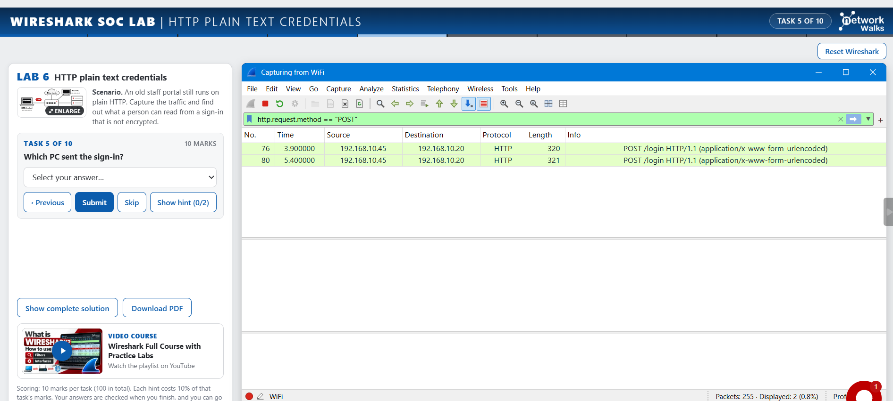
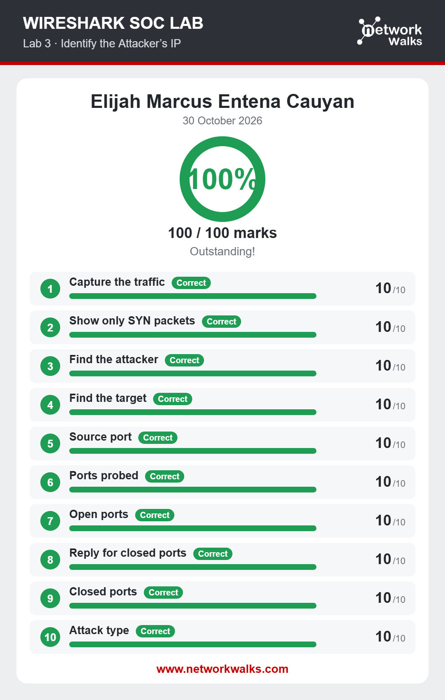
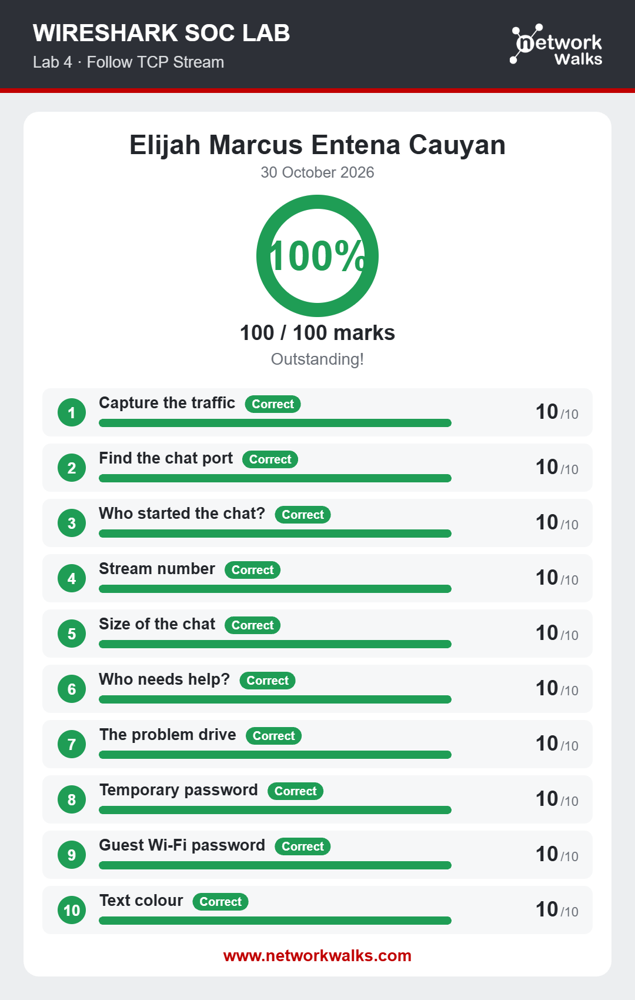
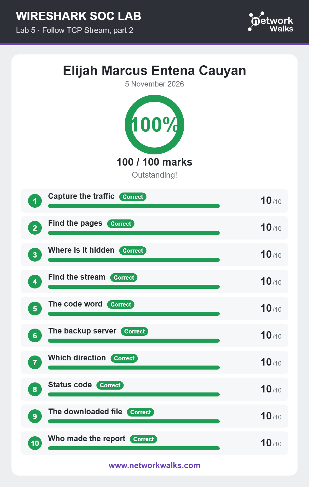
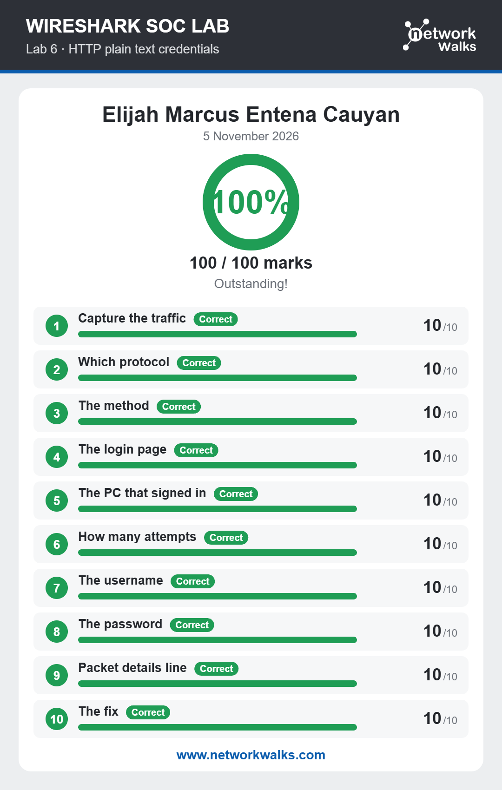
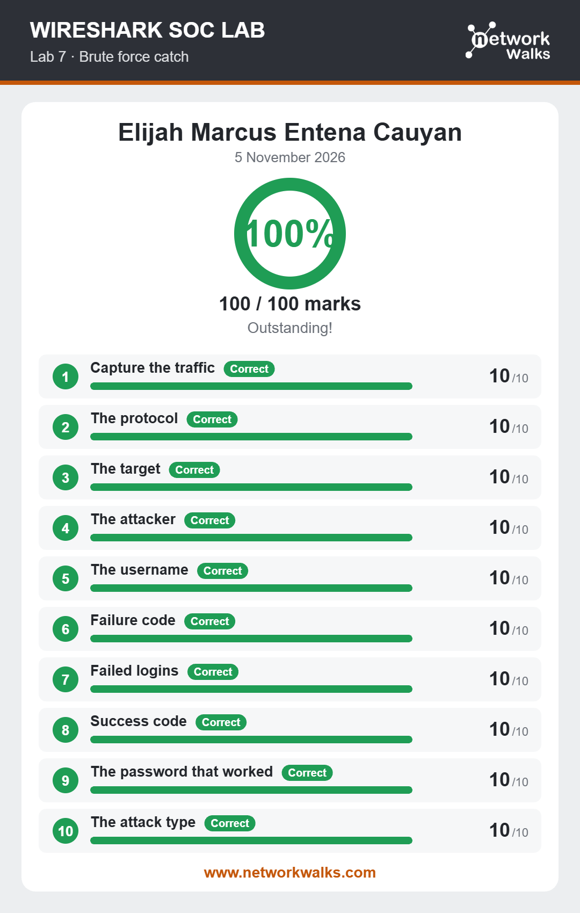
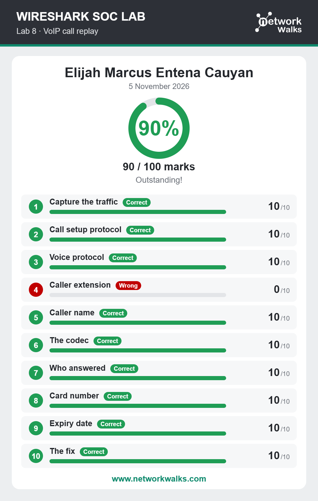

# Wireshark Labs
**Lab Overview**

This lab focuses on utilizing the networking tool Wireshark, which is a network packet analyzer tool, and in this lab, I was able to do hands-on work when dealing with packets, such as protocol filtering, looking deeper into individual packets, identifying attacker IP addresses, etc.
 
 
**Lab Screenshots & Results**

Hands-on work with Wireshark filtering

 
 
Lab 3 Results

 
 
Lab 4 Results

 
 
Lab 5 Results

 
 
Lab 6 Results

 
 
Lab 7 Results

 
 
Lab 8 Results

 
 
**Lesson Learned**

Based on the various Wireshark work that I dealt with during my week one internship with Networkwalks, I can say that I gained many valuable experiences, such as becoming familiar with Wireshark and also learning the fundamentals and basics of how to navigate with the tool when attempting to accomplish certain objectives. Again, I would like to thank Networkwalks for this amazing opportunity to have hands-on experience with various cybersecurity tools.
